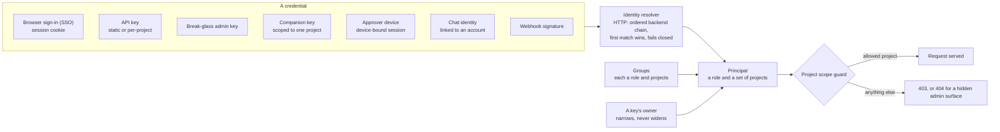

---
sources:
    - path: internal/featuredoctor/feature_auth.go
      sha256: c0d204531a03dd02c5e16a291d1d8fbedf061544fefad70b965c4358b151e715
    - path: internal/auth/backend.go
      sha256: bf8888283c2a4e0227ef66e62bb076d5aaec7c8c6b9a4502b60e2b138dc834b3
---
# Authentication & access control

!!! note "Community Edition — OIDC / SSO is Enterprise"

    Pluggable authentication ships in the **Community Edition**; **OIDC / SSO** is part of the **Enterprise Edition**. See [Editions](../editions.md).


vornik's control-plane API and UI can require authentication, and once a user is
authenticated their **role** and **project scope** decide what they can see and
do. This page covers turning auth on, the ways a request can be authenticated,
and the role/group model behind access control.

## Turning auth on

```bash
vornikctl doctor feature enable auth
```

This sets `api.auth_enabled` and restarts the daemon. **Have an admin key in
place before you enable it** — once on, unauthenticated requests to control-plane
routes are rejected, and an admin key is your way back in.

To roll it out cautiously, `api.auth_dry_run` evaluates and logs what *would*
happen on each request without actually enforcing — useful for confirming your
keys and groups are right before you flip enforcement on.

## Ways to authenticate

Requests are checked against an ordered chain of backends; the first one that
recognises a credential wins, and the chain **fails closed** on any unexpected
error. The shipped backends:

- **API keys** — static keys from config, and per-project database-backed keys
  (see below).
- **Browser sign-in (SSO)** — GitHub OAuth. A user clicks "Sign in with GitHub",
  and vornik creates a session cookie. An optional GitHub-organisation
  requirement gates who may sign in.
- **Break-glass admin keys** — always-on key access for operators, so an
  identity-provider outage can never lock you out.
- **Webhook signatures** — HMAC verification for inbound webhooks.

> Browser SSO ships with GitHub today. The backend is built around a provider
> interface so additional identity providers can slot in behind the same
> session and role machinery later.

### Per-project API keys

Issue scoped keys bound to a single project. Each key is stored hashed, carries
its own project, and can be limited to specific workflows:

```bash
vornikctl key create --project research-desk --name ci-bot --expires 90d
vornikctl key list   --project research-desk
vornikctl key rotate <keyID> --project research-desk
vornikctl key revoke <keyID> --project research-desk
```

A per-project key can't be repointed at another project by a request header — its
project is fixed at creation, which is what makes it safe to hand to an external
caller.

## Roles, groups, and project scope



Every route is reached the same way: one credential, one resolver, one guard.
A role is never inferred from a channel, and no request header can widen a
key's project.

Identities resolve to a **principal** with a role and a set of projects:

- **Roles.** There are two — `admin` (instance-wide) and `user` (project-scoped).
  A managed (hosted) instance adds a third for its owner. On the public
  address, an administrator's browser session is a `tenant_admin`. A
  `tenant_admin` may use a closed list of operator surfaces: the project
  wizard and gallery, MCP OAuth connections, the operator audit, the
  Credentials page, a project's Keys and MCP tools pages, and reading (never
  changing) the operator console's observation pages. The pages that show the
  daemon's configuration, its MCP server catalog, admin keys or accounts stay
  closed to it, even for reading. The full list:
  [Security model](../security-model.md#http-api-and-console).
- **Groups.** Users belong to groups; a group carries a role and a set of
  projects. Membership in any admin-role group makes a user an admin with access
  to everything. Otherwise a user's accessible projects are the union of their
  groups' projects.
- **Project scope enforcement.** A user's project set is stamped onto every
  request and checked by the same guard that prevents cross-project access. A
  freshly signed-in user who belongs to no group is *authenticated but sees
  nothing* — every project-scoped route returns `403` until they're added to a
  group.

The first admins are bootstrapped from configuration (`auth.bootstrap_admins`),
so there's always a way in on a fresh install. Users are provisioned
automatically on first sign-in.

## Break-glass admin access

Admin access is governed by the `admin` config block:

- `admin.enabled` turns the admin surface on. When it's off, `/ui/admin/*` URLs
  return `404` (not `403`) so they don't even reveal their existence to probes.
- `admin.allowed_keys` is the key-based break-glass path — admin keys are
  compared in constant time and keep working alongside SSO-based admins, so an
  identity-provider outage never locks the operator out.

## Audit

Every admin-initiated mutation — config edits, integration changes, danger-zone
confirmations — writes an audit row before it returns, so the trail survives even
a crash mid-change. Review it at `/ui/admin/audit`.

## Configuration reference

| Key | Meaning |
|-----|---------|
| `api.auth_enabled` | require authentication on control-plane routes |
| `api.auth_dry_run` | evaluate + log auth without enforcing |
| `server.accepted_hosts` | with auth off (or dry-run): extra `Host` names the daemon answers; any other name gets 403 (DNS-rebinding guard). IP addresses, `localhost` and the public base URL's host need no entry |
| `auth.bootstrap_admins` | identities seeded into the first admin group (`channel:external_id`) |
| `auth.external_base_url` | public base URL, required when a sign-in provider is set |
| `auth.session.lifetime` / `auth.session.idle_timeout` | session expiry controls |
| `auth.providers.github.client_id` / `client_secret_file` | GitHub OAuth credentials |
| `auth.providers.github.org` | restrict/soft-gate sign-in to a GitHub organisation |
| `auth.providers.github.org_member_role` | auto-grant org members this role on login (`user`/`admin`; empty = approve manually) |
| `auth.providers.github.org_member_projects` | projects an auto-granted `user`-role org member receives (`*` = all) |
| `admin.enabled` / `admin.allowed_keys` | admin surface + break-glass keys |
